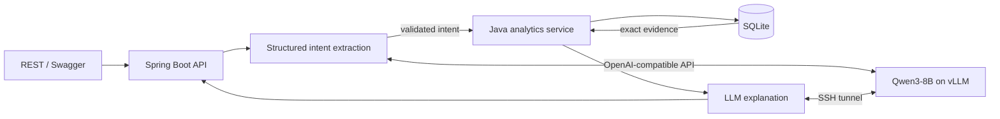

# Architecture

## Runtime flow

The LLM has no database credentials and cannot submit SQL. It selects one of five fixed intents. Java validates all parameters before executing repository-owned SQL. Monetary evidence is returned to the API caller, making model statements independently checkable.

## Modules

- `transaction`: transaction model, filtering, persistence, and demo-data loading.
- `analytics`: read-only aggregate queries.
- `assistant`: intent extraction, validation, orchestration, and explanations.
- `common`: shared pagination and API error handling.

This is a modular monolith. The boundaries are visible without adding network calls, deployment units, or distributed failure modes.

## Failure behavior

- Invalid filters or model-generated parameters return HTTP 400.
- An unavailable or malformed model response returns HTTP 503 only from the assistant endpoint.
- Transaction browsing and database health do not depend on the GPU.
- Unsupported questions return a constrained successful response describing the POC capabilities.

